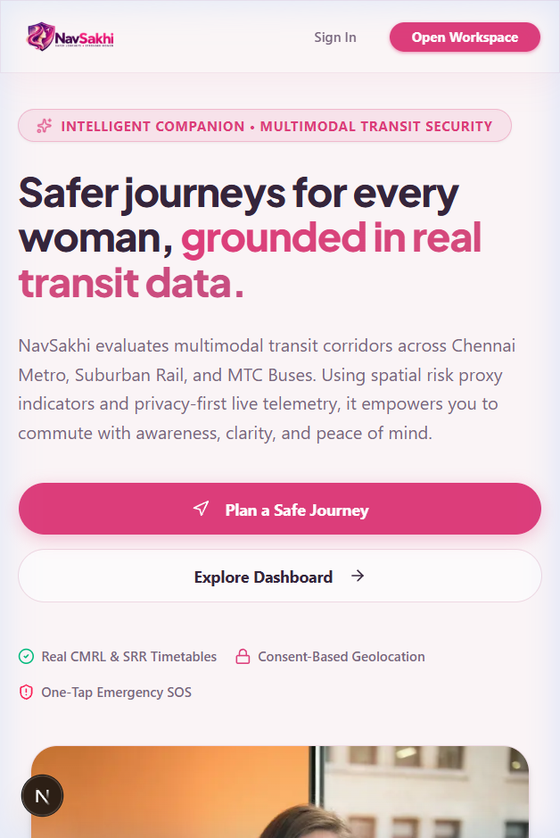
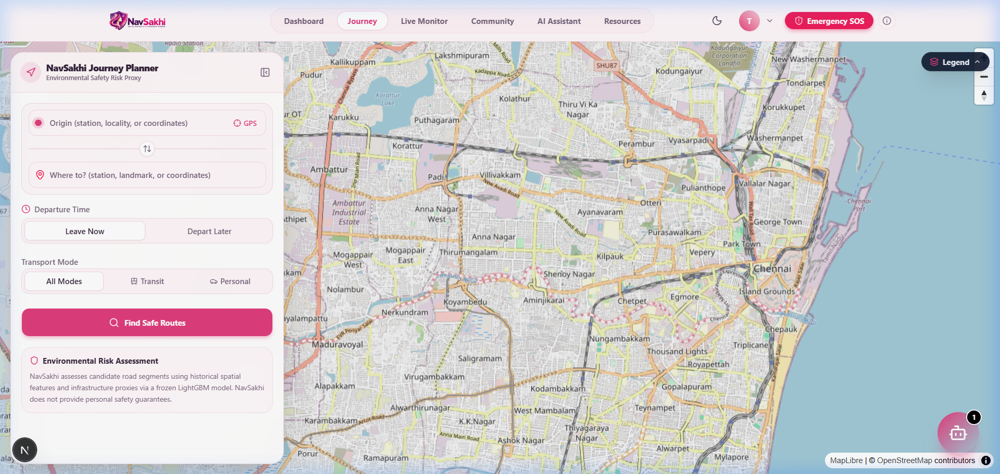
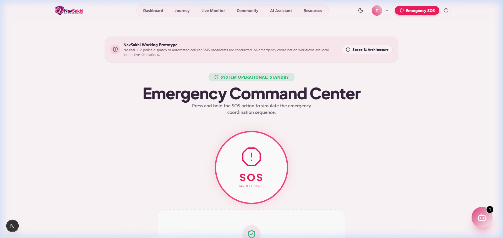

# NavSakhi — Safer Journeys • Stronger Women

**NavSakhi** is a personal-interest software project and working prototype engineered to explore women's safety-aware journey planning, multimodal Chennai urban transit routing, environmental risk-proxy scoring, real-time meteorological observations, and privacy-conscious location features.

It was created to showcase modern full-stack development, geospatial feature engineering, machine learning inference integration, and defensive security engineering through a personal portfolio and LinkedIn.

> [!NOTE]
> **Prototype Disclosures:** NavSakhi is a personal software project and working prototype. It is not an academic assignment or a commercial public safety product. Its Emergency SOS flow is an architectural simulation: it demonstrates nearest safe haven routing and user-initiated native device sharing, but does not conduct live police dispatch or automated cellular emergency broadcasts.

---

## 📸 Interface Preview

| Landing & Navigation | Multimodal Route Planner | Emergency Prototype Disclosures |
|:---:|:---:|:---:|
|  |  |  |

---

## 🌟 Implemented Features

1. **Multimodal Urban Transit Routing:**
   - Unified pathfinding across Chennai Metro Rail (CMRL), Southern Railway (SRR) suburban lines, Metropolitan Transport Corporation (MTC) buses, and pedestrian walking corridors.
   - Statutory tariff calculations for CMRL Metro (₹10–₹50) and SRR Suburban trains.
   - Honest handling of unintegrated transit feeds: MTC bus legs display `Fare unavailable` rather than fabricated values.
2. **Environmental Risk-Proxy Machine Learning:**
   - Genuine frozen LightGBM regression model scoring road segments based on 41 canonical OpenStreetMap and spatial infrastructure features.
   - Computes environmental risk indicators: street lighting, proximity to police stations and hospitals, pedestrian crossings, commercial density, and human activity levels.
   - Transit rights-of-way (subway tunnels, viaducts, railway tracks) are not road segments and remain explicitly unscored (`null`).
   - Native TreeSHAP feature contributions explain the positive and negative factors influencing each road corridor's score.
3. **Public Guest Workspace:**
   - Unauthenticated visitors can freely plan journeys, inspect transit timetables, check weather conditions, and review legal resources without creating an account or storing cookies.
4. **Meteorological Context:**
   - Real-time weather observations powered by Open-Meteo open weather API (temperature, feels-like, humidity, wind speed, WMO weather descriptions, and current UV index).
5. **Simulated Emergency SOS & Safe Haven Routing:**
   - Dynamically identifies nearest safe havens (police stations and hospitals) using spatial proximity and OSRM walking routes.
   - Free, user-initiated native device sharing via Web Share API (`navigator.share`), SMS deep-linking, or clipboard copy.
   - Prominently provides direct click-to-dial links for India's National Emergency Number (**112**) and Women's Helpline (**1091**).
6. **Privacy-First Live Companion Telemetry:**
   - Live telemetry monitoring with single-use WebSocket tickets and explicit runtime GPS consent.
7. **Constitutional Legal Rights Directory:**
   - Comprehensive legal resources explaining statutory protections in India: *Zero FIR*, *Virtual Complaints*, and *CrPC Section 46(4)*.

---

## 🛠️ Technology Stack

- **Frontend:** Next.js 16 (App Router), React 19, TypeScript, Tailwind CSS, Framer Motion, MapLibre GL, Lucide Icons, Sonner.
- **Backend:** FastAPI (Python 3.10), Uvicorn, Pydantic v2, Motor (Async MongoDB driver).
- **Machine Learning & Geospatial:** LightGBM, Scikit-Learn, Pandas, NumPy, Shap (TreeSHAP), SciPy KD-Tree, Shapely, PyArrow (Parquet).
- **Routing & External APIs:** OpenStreetMap (OSM), Open Source Routing Machine (OSRM), Open-Meteo Weather API.
- **Security:** Passlib (bcrypt password hashing), PyJWT (HS256 tokens), Single-use WebSocket ticket broker.

---

## 🏗️ Architecture & Request Flow

```
[Browser / Next.js Client]
         │
         ├── Guest Request (Public) ─────► [FastAPI /api/v1/journeys/guest/plan]
         │                                       │
         │                                       ▼
         │                        [JourneyIntelligenceCoordinator]
         │                           ├── CMRL Metro Graph (41 stations, statutory fares)
         │                           ├── SRR Suburban Graph (80 stations, statutory fares)
         │                           ├── MTC Bus Network (709 routes, unintegrated fares)
         │                           └── OSRM Pedestrian / Road Engine
         │                                       │
         │                                       ▼
         │                             [SpatialMatchingService]
         │                           (Snaps road legs to OSM segment IDs;
         │                            rail & metro corridors explicitly unscored)
         │                                       │
         │                                       ▼
         │                          [Frozen Preprocessing Pipeline]
         │                           (41 canonical infrastructure features)
         │                                       │
         │                                       ▼
         │                              [Frozen LightGBM Model]
         │                           (Environmental risk-proxy score [0-100])
         │                                       │
         │                                       ▼
         │                         [TreeSHAP Feature Explanations]
         │                           (Positive & negative corridor factors)
         │                                       │
         ├── Weather Context ───────────► [Open-Meteo Weather API]
         │                                 (Live temperature, UV, precipitation)
         │
         ├── Authenticated Workflow ────► [FastAPI /api/v1/auth & /users]
         │                                       │
         │                                       ▼
         │                            [MongoDB Persistence Layer]
         │                             (Atlas or local: bcrypt hashed passwords,
         │                              emergency contacts; fails closed if unconfigured)
         │
         ├── Live Telemetry (Consent) ──► [WebSocket Gateway /ws/journey]
         │                                 (Single-use tickets, GPS streaming)
         │
         └── Emergency Simulation ──────► [FastAPI /api/v1/emergency]
                                           (Nearest safe havens via OSRM,
                                            native sharing & click-to-dial 112)
```

---

## 🚀 Getting Started Locally

### Prerequisites
- Node.js 20+ and npm
- Python 3.10+
- Optional: MongoDB 6.0+ or MongoDB Atlas (Only required for account persistence; guest browsing and multimodal routing work without a database)

### 1. Clone & Configure Environment
```bash
git clone https://github.com/<your-username>/NavSakhi.git
cd NavSakhi

# Copy backend environment template
cp .env.example .env

# Configure MongoDB (Optional for guest exploration, required for account creation):
# In .env, set MONGODB_URI="mongodb+srv://<user>:<password>@<cluster>.mongodb.net/?retryWrites=true&w=majority"
# Or for local MongoDB: MONGODB_URI="mongodb://localhost:27017"

# Copy frontend environment template
cd frontend && cp .env.example .env.local && cd ..
```

### 2. Backend Setup
```bash
# Create and activate virtual environment
python -m venv venv
# Windows:
.\venv\Scripts\activate
# Linux/macOS:
source venv/bin/activate

# Install dependencies
pip install -r requirements.txt

# Start FastAPI server
python -m uvicorn app.main:app --host 127.0.0.1 --port 8000
```
Backend API interactive documentation is available at `http://127.0.0.1:8000/docs`.

### 3. Frontend Setup
```bash
cd frontend
npm install
npm run dev
```
Navigate to `http://localhost:3000` to open the NavSakhi workspace.

---

## 🧪 Testing & Verification

Run verified regression suites locally:

```bash
# Backend Pytest Suites (93 passed tests)
python -m pytest tests/test_phase28_mongodb_persistence.py -v
python -m pytest tests/test_phase27_registration_and_auth.py -v
python -m pytest tests/test_phase25_academic_demo_access.py -v
python -m pytest tests/test_ml_route_scoring_phase5.py -v
python -m pytest tests/test_phase13_score_integrity.py tests/test_phase15_multi_route_generation.py tests/test_phase22_search_fare_map.py -v

# Frontend TypeScript Typecheck
cd frontend
npx tsc --noEmit

# Frontend Unit & Component Tests (58 passed tests)
npm test

# Production Webpack Build
npx next build --webpack
```

---

## 🔒 Security & Privacy Boundaries

1. **Environmental Risk Proxy:** Route scores reflect environmental infrastructure indicators (illumination, emergency service access, pedestrian crossings). They do **not** forecast criminal behavior or guarantee absolute personal safety.
2. **Transparent Transit Leg Scoring:** Train tracks, tunnels, and elevated corridors are not physical roads. NavSakhi explicitly marks them as unscored rather than inventing misleading values.
3. **Privacy-Conscious Geolocation:** Coordinates are never transmitted silently. User coordinates are accessed solely when an explicit interaction is initiated (e.g., clicking *"Detect My Location"*).
4. **Zero Live Emergency Dispatch:** The Emergency SOS flow is an educational prototype simulation. In genuine danger, users must dial **112** directly.

---

## 🔮 Future Work

- [ ] Ingestion of real-time transit telemetry (GTFS-RT) for live train and bus delays.
- [ ] Integration with a certified emergency SMS gateway for authorized account notifications.
- [ ] Expansion of multimodal routing graphs to additional metropolitan corridors.
- [ ] Native mobile builds for iOS and Android.

---

## 📄 License
This project is licensed under the MIT License for personal and demonstration purposes.
Transit data from CMRL and Southern Railway are public domain / official statutory schedules.
Map data &copy; [OpenStreetMap contributors](https://www.openstreetmap.org/copyright). Weather data powered by [Open-Meteo](https://open-meteo.com/) (CC BY 4.0).
