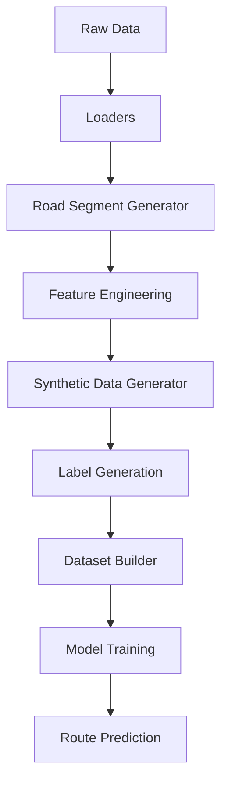

# SafeShe ML Architecture V2

This document defines the second-generation Machine Learning architecture for the SafeShe platform. It formally transitions the platform from macro-level district risk estimation to micro-level road-segment safety prediction.

This is an architecture specification only. No implementation details or code are included.

---

## 1. Current Direction

The fundamental shift in V2 is the transition of the primary prediction target:

**From:** `District` → `Safety`
**To:** `Road Segment (100–200 m)` → `Safety`

In this paradigm, **district-level crime is no longer the prediction target.** Instead, district crime statistics are treated as a **background prior** (macro risk). The actual safety prediction is determined by the micro-level environmental, infrastructure, and crowd factors of the specific road segment a user is traversing.

---

## 2. The Complete ML Pipeline

The V2 pipeline constructs high-resolution tabular datasets by fusing multiple spatial streams at the road-segment level.

### Pipeline Flow

1. **Raw Data**: Ingestion of OSM, Crime, WorldPop, and Weather.
2. **Loaders**: Standardization of raw data into canonical formats (e.g., Crime Loader standardizing TN districts).
3. **Road Segment Generator**: Breaking continuous spatial networks into discrete 100-200m ML samples.
4. **Feature Engineering**: Spatially joining loader outputs to the generated segments.
5. **Synthetic Data Generator**: Simulating missing micro-infrastructure (CCTV, lighting) based on real-world context.
6. **Label Generation**: Creating the deterministic `safety_score` and `crowd_score` regression targets.
7. **Dataset Builder**: Assembling the final training and validation CSVs.
8. **Model Training**: Fitting the ML models (Crowd and Safety predictors).
9. **Route Prediction**: Running inference on user-requested paths.

---

## 3. Prediction Unit

In V2, every training sample is uniquely identified by:
**(latitude, longitude, timestamp)** 
*Note: Lat/lon represent the centroid of a specific road segment.*

### Why this produces better spatial predictions
Predicting at the district level assumes uniform risk across vast areas. In reality, safety varies block by block. A well-lit, heavily foot-trafficked commercial street and a dark, isolated alleyway may exist in the exact same high-crime district, but they present vastly different real-world risks. By making the prediction unit a specific coordinate and time, the model captures the true localized environment a user experiences.

---

## 4. Feature Hierarchy

Features are grouped logically based on their spatial resolution and source. 

- **Background Features**: `crime_score`, `commissionerate_flag` (Macro-level priors).
- **Road Features**: `road_type`, `max_speed`, `sidewalk_presence`, `oneway` (Infrastructure specifics).
- **POI Features**: `restaurant_count`, `bus_stop_count`, `metro_count`, `hospital_distance`, `police_distance` (Local attractions and security).
- **Population Features**: `population_density` (Baseline foot-traffic pressure).
- **Environmental Features**: `weather`, `weather_risk` (Dynamic conditions).
- **Temporal Features**: `hour`, `day_of_week`, `weekend` (Time-based modifiers).
- **Synthetic Features**: `lighting_score`, `cctv_presence`, `road_maintenance`, `visibility` (Simulated micro-infrastructure).
- **Community Features**: `community_reports` (Crowd-sourced sentiment and live alerts).

---

## 5. Role of Crime

It is a core tenet of Architecture V2 that **District Crime is only a Background Prior, not Road Risk.**

### Influence on Prediction
Crime acts as the "intercept" or baseline risk for a geographic area. The ML model learns to shift this baseline up or down based on micro-features. For example:
- **High-Crime District + Excellent Lighting + High Crowd Density** = Safe road segment.
- **Low-Crime District + No Lighting + Industrial Zone** = Unsafe road segment.

The model does not predict crime; it predicts the immediate situational safety of a specific segment.

---

## 6. Road Segment Generator

The Road Segment Generator bridges the gap between raw maps and ML samples.

- **Inputs**: OpenStreetMap (OSM) road networks (ways and nodes).
- **Outputs**: Discrete, uniform road segments representing the physical world.
- **Segment Length**: `100–200 meters`. This is long enough to aggregate meaningful POI data, but short enough to capture abrupt changes in lighting or sidewalk availability.
- **Segment IDs**: Unique deterministic hashes generated from the original OSM `way_id` combined with an offset index, ensuring reproducible dataset generation.
- **How OSM roads become ML samples**: Long, continuous OSM ways (which can span kilometers) are mathematically split into 100-200m chunks. The centroid of each chunk is calculated as the `(latitude, longitude)` anchor for all subsequent spatial joins.

---

## 7. Feature Engineering

Every loader contributes specific signals to the road segment anchor:
- **Crime Loader**: Joins the canonical `crime_score` based on the segment's district boundaries.
- **OSM Loader**: Executes spatial buffer queries around the segment centroid to extract POI counts (e.g., restaurants, transit) and road types.
- **Population Loader**: Samples the WorldPop raster at the segment centroid to attach `population_density`.
- **Weather Generator**: Attaches time-aware environmental risk (e.g., rain reducing visibility).

---

## 8. Synthetic Data Generator

To prototype a highly advanced safety model before massive IoT/real-world data streams are available, we utilize a Synthetic Data Generator.

- **Purpose**: To simulate critical micro-features (like street lighting, CCTV, and road maintenance) that are sparse in current OSM extracts.
- **Inputs**: The real-world context of the road segment (e.g., `road_type`, `commercial_density`, `metro_count`).
- **Outputs**: Plausible synthetic feature values.
- **Context-Dependent Simulation**: The generator **does not generate random noise.** It uses logical rules based on the real-world anchor. A segment identified as a major commercial road with a nearby metro station will deterministically generate high synthetic scores for CCTV and lighting. A residential road will generate lower visibility and lighting scores. 

---

## 9. Dataset Builder

The Dataset Builder assembles the final training dataset.

- **Columns**: 
  - Identifiers: `segment_id`, `latitude`, `longitude`.
  - Feature Hierarchy: All Background, Road, POI, Population, Environmental, Temporal, Synthetic, and Community features.
- **Target Labels**: 
  - `safety_score` (Target for Safety Model)
  - `crowd_score` (Target for Crowd Model, also used as an input to Safety)
- **Metadata**: `timestamp`, `schema_version`, `dataset_version`.

---

## 10. Inference Pipeline

When a user requests a route in the application, the inference pipeline dynamically calculates the journey's safety.

1. **Source**: The user inputs a Start and End location. A routing engine (like OSRM) returns a geographic polyline.
2. **Road Segments**: The polyline is discretized into the standard 100-200m segments.
3. **Feature Extraction**: Live and cached features (weather, time, OSM context, synthetic signals) are attached to each segment in real-time.
4. **Prediction**: The trained ML model predicts the `safety_score` independently for every segment.
5. **Aggregation**: The individual segment scores are aggregated (e.g., taking the lowest safety score as the bottleneck, or averaging across the corridor) to compute the route's overall viability.
6. **Final Route Risk**: The user is presented with a safe route and a granular, turn-by-turn safety breakdown.
