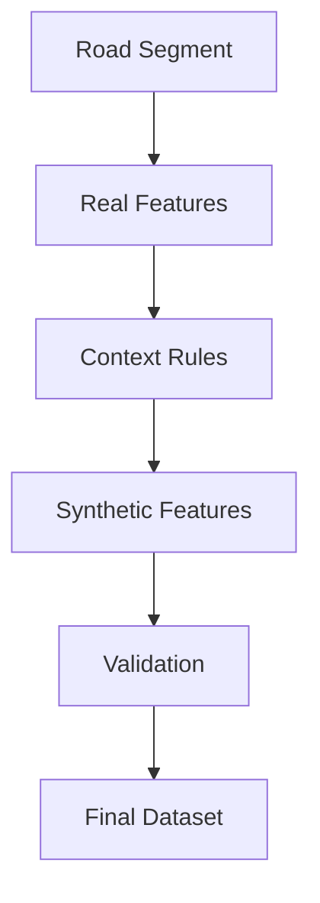

# Synthetic Feature Generator Design

This document outlines the architectural design for the Synthetic Feature Generator within the SafeShe Dataset Engineering pipeline.

This is an architecture specification only. No implementation code is included.

---

## 1. Purpose

The Synthetic Feature Generator provides critical micro-level infrastructure and safety features that are sparse or missing in public datasets like OpenStreetMap. 

**Core Principle**: Synthetic data in SafeShe must NEVER be random. 

The generation process relies strictly on deterministic rules driven by real-world context. The generator acts as a sophisticated proxy engine—inferring the state of unmapped infrastructure based on the structural, commercial, and demographic realities of the road segment.

---

## 2. Generator Pipeline

The generation process follows a strict sequential pipeline, executed only after real features have been joined to the road segments.

1. **Road Segment**: The starting geographic anchor `(latitude, longitude)`.
2. **Real Features**: Verified data joined from OSM, WorldPop, and Crime datasets.
3. **Context Rules**: Mathematical scoring formulas applied to the real features.
4. **Synthetic Features**: The deterministic output (0–100 score).
5. **Validation**: Rule-based clipping to prevent logically impossible combinations.
6. **Final Dataset**: Integration of the synthetic scores into the ML pipeline.

---

## 3. Dependency Matrix

Every synthetic feature depends entirely on a verified subset of real features. 

| Synthetic Feature | Real Feature Dependencies |
|---|---|
| **Lighting** | `road_type`, `road_width`, `commercial_density`, `junction`, `population_density` |
| **CCTV** | `bank_count`, `atm_count`, `mall_count`, `commercial_density`, `junction`, `police_dist` |
| **Road Maintenance** | `road_type`, `surface`, `district`, `population_density`, `weather_risk` |
| **Night Activity** | `restaurant_count`, `cafe_count`, `metro_count`, `population_density`, `commercial_density` |
| **Visibility** | `road_curvature`, `road_width`, `tunnel`, `bridge`, `synth_lighting` |
| **Community Safety** | `crime_score`, `isolation_index`, `population_density`, `commercial_density` |

---

## 4. Feature Generation Strategies

### 4.1 Lighting
- **Purpose**: Estimate the quality and coverage of street lighting on the segment.
- **Inputs**: `road_type`, `commercial_density`, `junction`, `population_density`.
- **Deterministic generation logic**: A baseline score is set by `road_type` (e.g., primary roads receive a high baseline, residential alleys a low baseline). This is augmented by `commercial_density` (commercial zones are heavily lit) and penalized by very low `population_density` (isolated areas).
- **Expected range**: `0 to 100`
- **Validation rules**: Cannot exceed 30 if `road_type` is `track` or `path` in a low-density zone.
- **Confidence score**: High. Highway classification and commercial zoning are strong predictors of municipal lighting.
- **Future replacement**: Smart city IoT light sensors or municipal light-pole databases.

### 4.2 CCTV
- **Purpose**: Estimate the probability of active CCTV surveillance covering the segment.
- **Inputs**: `bank_count`, `atm_count`, `mall_count`, `commercial_density`, `junction`.
- **Deterministic generation logic**: Heavily weighted by the presence of high-value POIs (Banks, ATMs, Malls inherently possess CCTV). Major `junction` nodes in urban areas also increase the score.
- **Expected range**: `0 to 100`
- **Validation rules**: Cannot exceed 10 if `commercial_density` is 0 and no high-value POIs are within 50m.
- **Confidence score**: Medium-High. Corporate and banking POIs practically guarantee surveillance spillage onto the street.
- **Future replacement**: Municipal CCTV registries or crowdsourced camera mapping (e.g., Mapillary).

### 4.3 Road Maintenance
- **Purpose**: Estimate physical road quality (potholes, waterlogging risk, evenness).
- **Inputs**: `road_type`, `surface`, `district`, `population_density`.
- **Deterministic generation logic**: The `surface` tag (`asphalt` vs `unpaved`) sets the ceiling. Major `road_type` (highways, trunk roads) implies higher municipal upkeep priority. 
- **Expected range**: `0 to 100`
- **Validation rules**: Score locked below 40 if `surface` is `dirt`, `unpaved`, or `gravel`.
- **Confidence score**: Medium. Local municipal efficiency varies widely even on primary roads.
- **Future replacement**: Accelerometer data from smartphones or vehicle fleets (e.g., Uber/Ola).

### 4.4 Night Activity
- **Purpose**: Estimate the ambient "eyes on the street" foot traffic during nighttime hours (8 PM - 2 AM).
- **Inputs**: `restaurant_count`, `cafe_count`, `metro_count`, `population_density`.
- **Deterministic generation logic**: Directly proportional to late-night POIs (restaurants, cafes, metro stations) combined with local residential density.
- **Expected range**: `0 to 100`
- **Validation rules**: Must strictly drop to near 0 in industrial or pure office zones with no late-night POIs.
- **Confidence score**: High. Commercial zoning dictates nightlife.
- **Future replacement**: Telecom cell-tower density logs or live transit tap-in data.

### 4.5 Visibility
- **Purpose**: Estimate structural line-of-sight and situational awareness on the road segment.
- **Inputs**: `road_curvature`, `road_width`, `tunnel`, `synth_lighting`.
- **Deterministic generation logic**: Decreases sharply with high `road_curvature` (blind corners) and narrow `road_width`. Plummets if the segment is a `tunnel` without maximum `synth_lighting`.
- **Expected range**: `0 to 100`
- **Validation rules**: Cannot exceed 40 if `road_curvature` implies sharp, blind switchbacks.
- **Confidence score**: Very High. Entirely derived from exact geometric properties.
- **Future replacement**: LiDAR scanning or Google Street View image segmentation.

### 4.6 Community Safety
- **Purpose**: Prototype a crowd-sourced sentiment or "vibes" score for the segment.
- **Inputs**: `crime_score`, `isolation_index`, `commercial_density`.
- **Deterministic generation logic**: Inversely proportional to the macro `crime_score` and `isolation_index`. Boosted by moderate `commercial_density`.
- **Expected range**: `0 to 100`
- **Validation rules**: Cannot be high if `isolation_index` is extreme and `crime_score` is poor.
- **Confidence score**: Low. Sentiment is highly subjective.
- **Future replacement**: Actual user reviews, SafeShe in-app reporting, or social media sentiment analysis.

---

## 5. Validation

Strict logical clipping prevents the generator from outputting impossible values, anchoring the synthetic data to reality.

- **No high lighting score on isolated rural roads**: If `population_density` < threshold AND `commercial_density` == 0, `synth_lighting` is capped tightly, regardless of road type.
- **No high CCTV probability without commercial activity**: If the segment contains purely residential housing and no retail/banking POIs, `synth_cctv` must be <= 10.
- **No high night activity in low-population industrial areas**: High office density with zero restaurants or residential population must result in a near-zero `synth_night_activity` score after 8 PM.

---

## 6. Output

The generator acts as an internal module during Feature Engineering. 

- **Output**: It generates a tabular matrix containing `segment_id` and the 6 synthetic feature columns.
- **Integration**: It seamlessly `LEFT JOIN`s these columns onto the master road segment dataframe.
- Because it relies purely on pre-joined real features, the generator executes extremely quickly in memory without requiring additional spatial queries or API calls.
