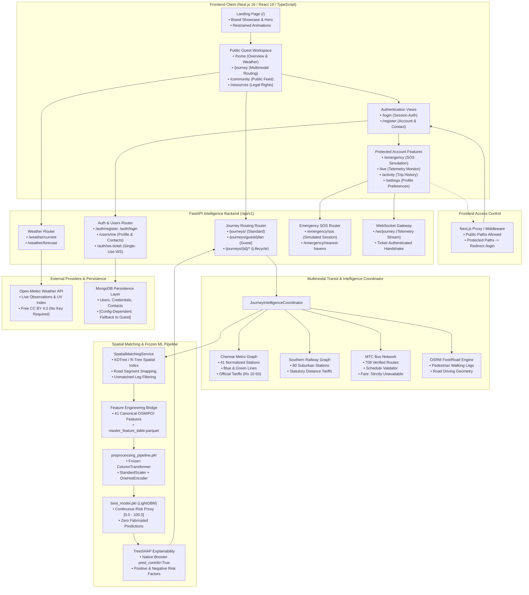

# NavSakhi — System Architecture & Technical Specifications

**Official Brand:** NavSakhi — Safer Journeys • Stronger Women  
**Project Classification:** Personal Software Project & Working Prototype  
**Scope:** Women's safety-aware journey planning, multimodal Chennai urban transit routing, environmental risk-proxy scoring, real-time meteorological observations, and privacy-conscious location features.

---

## 1. High-Level Architecture Overview

NavSakhi follows a modern decoupled architecture consisting of a **Next.js 16 (React 19, TypeScript, Tailwind CSS)** frontend and an asynchronous **FastAPI (Python 3.10)** intelligence backend.

---

## 2. Core Architectural Pillars

### 2.1 Public Guest vs. Authenticated Boundaries
1. **Public Guest Experience:**
   - Unauthenticated visitors can freely plan multimodal routes, browse transit schedules, inspect official metro and suburban rail tariffs, explore interactive maps, view live Open-Meteo weather data, and read legal rights resources.
   - Guest route planning executes via `journey_service.plan_guest_journey()`: candidate routes are generated and evaluated through the real LightGBM model without persisting personal records to the database.
2. **Authenticated Account Experience:**
   - Private live tracking sessions, personal journey history, custom profile preferences, and emergency contact configurations strictly require authentication.
   - Protected endpoints require signed, expiring JWT access tokens in the `Authorization: Bearer <token>` header.
   - Unauthenticated attempts to access protected frontend routes are intercepted by Next.js middleware and redirected to `/login?redirect=<target>`.

### 2.2 Truthful Multimodal Transit Routing
NavSakhi does not synthesize fictional transit routes or make ungrounded claims:
- **CMRL Metro Rail:** 41 normalized stations across Blue and Green lines with official timetable schedules and statutory fare slabs (₹10 to ₹50).
- **Southern Railway (SRR) Suburban:** 80 suburban stations covering Chennai Beach, Tambaram, Chengalpattu, Central-Arakkonam, and Gummidipoondi corridors with official distance-based tariffs.
- **MTC Feeder Buses:** 709 verified Chennai bus routes validated against stop sequences. Because automated fare APIs are not integrated, fares are honestly marked as `Fare unavailable` without guesswork.
- **Pedestrian & Road:** Generated via OpenStreetMap road network and local OSRM instance.

### 2.3 Frozen Machine Learning Route Scoring
- **Artifact Security:** All models and datasets are frozen and cryptographic SHA-256 hashes are verified at cold startup before deserialization:
  - `best_model.pkl`: `bb8e6b04895caf1ca6efcaf37a7994b42690bb8b6237114507f7fa0ba8070dde`
  - `preprocessing_pipeline.pkl`: `c1ad4c28ae5ef5a7c3867535c16d9e6fdf0729a34027a18f463c0a1b79c550cd`
  - `road_segments.parquet`: `ffee5ce98efda020cbcf7c6e280bd46b73e1d035fa29741a49941fdd2aaa8d8b`
  - `master_feature_table.parquet`: `72557fcabb752709e1e8e7500da706179275d3173e30d9ce6da0e41c1a3433e5`
- **Model Nature:** The LightGBM regressor evaluates **environmental risk-proxy indicators** (lighting density, police station proximity, hospital access, pedestrian crossings, commercial density, area desertion factors).
- **Strict Boundary:** It is **not** a crime predictor or guarantee of personal safety.
- **Transit Leg Scoring:** Dedicated transit rights-of-way (subway tunnels, elevated viaducts, railway tracks) are not road segments and are explicitly marked as unscored (`safety_score = null`), maintaining absolute scientific integrity.

### 2.4 Emergency SOS & Safe Haven Architecture
- **Simulated Emergency Workflow:** NavSakhi demonstrates a simulated emergency response sequence.
- **No Live Dispatch:** It does **not** call police dispatch, trigger automatic 112 calls, or send automated cellular SMS messages.
- **User-Initiated Native Sharing:** Location sharing uses the browser's native Web Share API (`navigator.share`), SMS deep-links, or clipboard copying with explicit user consent.
- **Safe Haven Routing:** Nearest police stations and hospitals are dynamically identified and routed using spatial proximity and OSRM walking directions.
- **Direct Helplines:** The interface prominently features direct phone dialer links to India's National Emergency Number (**112**) and Women's Helpline (**1091**).

### 2.5 Database Persistence Model
- Configured via `MONGODB_URI` environment variable.
- When an external MongoDB URI is absent or unreachable, registration returns a clear `503 DATABASE_UNAVAILABLE` message (*"Database configuration unavailable. Account creation requires a configured database. Please continue exploring as a guest."*) while allowing full guest browsing.
- In-memory test doubles (`InMemoryUserRepository`) are used exclusively in automated test suites to verify persistence contracts in isolation without requiring external credentials.
